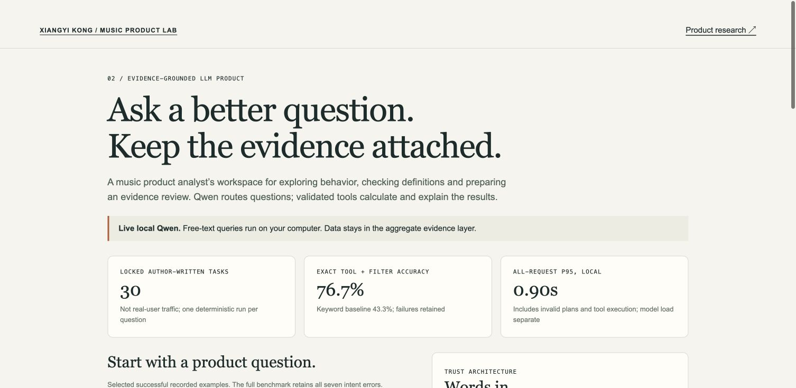

# Music Insights Copilot

[](https://github.com/xkong585/music-insights-copilot/actions/workflows/validate.yml)

**Product job:** help a music product manager examine behavior, confirm metric definitions, switch cohorts and prepare an evidence review with fewer analyst handoffs.

Real **Qwen3-4B local inference**, validated tool plans and parameterized DuckDB queries over real Last.fm aggregates. This is a language interface to auditable evidence; it is not unrestricted text-to-SQL.

[Recorded-run showcase](https://xkong585.github.io/music-insights-copilot/) · [Product scope](docs/product_brief.md) · [Full runs and failures](evidence/runs.json) · [Measured benchmark](evidence/evaluation.json)



## Measured final benchmark

| Measure | Result |
|---|---:|
| Frozen author-written tasks | 30 |
| Exact tool + cohort + filters | 76.7% |
| Tool selection | 76.7% |
| Keyword baseline exact match | 43.3% |
| Valid output schema | 90.0% |
| All-request p50, local | 0.70 s |
| All-request p95, local | 0.84 s |

These are author-written evaluation tasks, **not real users or fabricated listening records**. The initial 32-task development run failed because the smaller model copied schema option strings. That run is preserved in `evidence/development-v1/`. The revised prompt/model was fixed before the new final cases were executed. A backend-only rebuild stabilized bootstrap user ordering; the prior measurement is retained in `evidence/backend-v1/`. The final rerun uses the identical frozen model, prompt and questions. No improvements in user productivity, adoption or retention have been measured. One run per final case; narrow bilingual benchmark, not population accuracy or production latency. All failures are retained.

## Run the actual live product

Apple Silicon with Python 3.12:

```bash
python -m venv .venv
source .venv/bin/activate
pip install -r requirements.txt
python src/server.py --model mlx-community/Qwen3-4B-Instruct-2507-4bit
```

Open **http://127.0.0.1:8767/**. The first run downloads approximately 2.26 GB of open weights. Model load is separate from measured per-request latency. No paid inference API key is needed. The reference tested revision is recorded in `evidence/model_manifest.json`; use that revision's local snapshot for exact reproduction. This implementation targets Apple Silicon/MLX, not an untested Linux deployment.

```bash
python src/evaluate.py --model /path/to/pinned/local/snapshot
pytest tests -q
```

The hosted static showcase clearly replays recorded actual model executions and disables free-text live calls. It does **not** pretend to host a running LLM. The local server handles new questions and prior-plan context.

## Architecture

Question + prior plan → local Qwen JSON plan → strict schema → one of seven supported tools → parameterized SQL over pinned aggregates → deterministic numerical readout with source hash and limitations.

Supported: overall artist repeat, behavior groups, cohort sensitivity, definitions and product next-step memo. Unsupported: subscriptions, Amazon customers, revenue, skips, personal logs, arbitrary SQL and causal feature impact. Schema-valid intent errors remain possible; the interpreted plan is shown.

## Source and reproducibility

Aggregate evidence is copied byte-for-byte from [Music Discovery Product Analysis](https://github.com/xkong585/music-discovery-product-analysis), using the original [Celma/MTG-UPF author release](https://zenodo.org/records/6090214), attributed to [Last.fm](https://www.last.fm/). Data is non-commercial; no individual logs or profiles are redistributed. Every response includes aggregate evidence SHA-256 and original archive SHA-256.

Model: [MLX Community Qwen3-4B-Instruct-2507-4bit](https://huggingface.co/mlx-community/Qwen3-4B-Instruct-2507-4bit), converted from Qwen, Apache-2.0 model license. Local tokenizer counts are measured; hardware/electricity and dollar cost per valid response are not measured. No cost-savings or production-ROI claim.

## Portfolio wording

Built a local Qwen-powered music analytics Copilot with constrained tool selection, parameterized SQL and source-linked numerical responses over real listening aggregates.

Evaluated 30 frozen bilingual task cases against a keyword baseline; achieved 76.7% exact tool/filter accuracy with 0.84s all-request p95 in the local benchmark, retaining failures and separating offline task metrics from user outcomes.

See [failure analysis and release decision](docs/failure_analysis.md). This is a research prototype; the free-text planner is not recommended for unattended business decisions.
